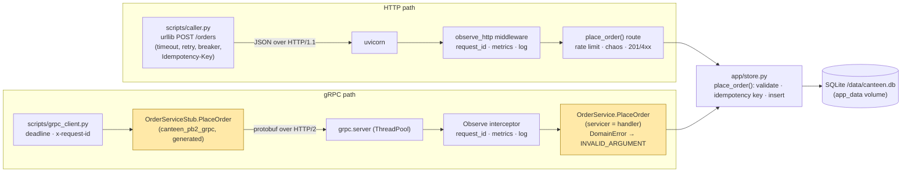
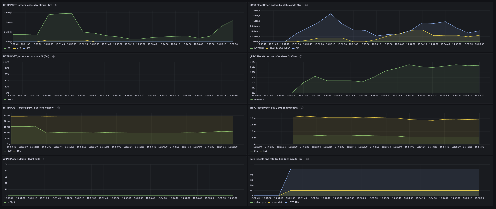

# canteen — Assignment 2 report: HTTP APIs, gRPC, and Metrics

Enterprise Software Development, Fall 2026 — Assignment 2. Individual submission; extends the Assignment 1 project in this directory (`REPORT.md`). Branch `assignment2`.

What was added: `app/store.py` (the business rules and a SQLite store shared by both processes), a reworked `app/main.py`, `app/ratelimit.py`, `grpc_service/` (proto, generated code, server), `scripts/caller.py`, `scripts/grpc_client.py`, `scripts/ratelimit_demo.sh`, `openapi.json`, `monitoring/grafana/dashboards/grpc.json`, the `grpc` compose service and Prometheus job, 10 new tests (22 in all). Raw outputs quoted below are in `scripts/results/a2_*.txt`. `README.md` has the run and test commands.

---

## Part A: Improve the HTTP API

### A.1 REST constraints

| Constraint | Plain meaning | In this API |
|---|---|---|
| Client–server | The client (UI, script, other service) and the server evolve separately; they only share the HTTP contract. | Yes: `scripts/load.py`, `scripts/caller.py`, Swagger UI and the A1 experiment scripts are all independent clients of the same API. |
| Stateless | Every request carries all the server needs; the server keeps no per-client session between requests. | Yes: shop and item are in the body, `Idempotency-Key` and `X-Client-ID` in headers; the server stores resource state (orders), not conversations. |
| Cacheable | Responses say whether a client or proxy may reuse them. | Not demonstrated: no `Cache-Control` headers; the resources change state, so the right answer would be `no-store`. |
| Uniform interface | Resources have identifiers, are handled through representations, messages describe themselves, links drive the next step. | Partly: `/orders/{order_id}` identifies an order, JSON is the representation, status codes and the one error shape make messages self-describing. Hypermedia links (HATEOAS) are not demonstrated. |
| Layered system | A client cannot tell whether it talks to the server directly or through intermediaries. | Not demonstrated: there is no proxy or gateway in the stack, though nothing in a client would break if one were added. |
| Code on demand *(optional)* | The server may send code the client executes. | Only the Swagger UI page at `/docs`, which ships JavaScript the browser runs; the API itself sends none. |

### A.2 Review of the endpoints

All application endpoints were reviewed (`/health` and `/metrics` excluded). Three practices now apply to every one of them:

- **One error format.** Every failure is `{"error": {"code", "message", "details"}}` with `code` ∈ `validation_error | not_found | conflict | rate_limited | shop_closed | internal`. Done once, by exception handlers in `app/main.py` (`error_response`, `on_validation_error`, `on_http_exception`, `on_domain_error`), so no route builds its own error body.
- **Validation by the models.** `NewOrder.shop` and `Chaos.fail_shop` are `Literal[...]` over the four shops, `item` is 1–40 characters; anything else is 422 with the offending field in `details`. Unknown shop used to be a 400 built by hand.
- **Meaningful status codes.** 201 created, 200 read/transition, 204 reset, 404 unknown order, 409 impossible transition, 422 bad input, 429 rate limited, 503 shop closed.

**User task chosen: place an order** (`POST /orders`), before/after:

| Old endpoint | Problem | Change | Reason |
|---|---|---|---|
| `POST /orders {shop,item}` → 201; errors as `{"detail": "..."}` (a string) or `{"detail": [...]}` (a list for 422) | Two error shapes; a caller needs two parsers | Error envelope `{"error": {code, message, details}}` for every status | One parser, machine-readable `code` |
| unknown shop → `400 {"detail": "unknown shop; choose one of (...)"}` | A validation problem reported differently from other validation problems (422) | `shop: Literal[SHOPS]` → `422 validation_error`, details name the field and the allowed values | Consistent; the allowed values are now in the OpenAPI spec |
| a retried POST created a second order | A client that times out and retries duplicates the order | Optional `Idempotency-Key` header; the key→order mapping is stored; a repeat returns the first order with `Idempotent-Replayed: true` | Safe retries (used by `caller.py`) |
| no limit on new orders | One hot client can flood the queue | Fixed window of 60 orders per 60 s per client (`X-Client-ID`, else IP); `429` + `Retry-After` | Protects the service; the caller is told when to come back |

**Other endpoints changed:** `POST /chaos` → `PUT /chaos` (it replaces the whole settings object) and `POST /chaos/reset` → `DELETE /chaos` (204); an unknown `fail_shop` is 422, not 400. **Left alone:** `GET /orders/{order_id}`, `GET /shops`, `GET /chaos`, and `POST /orders/{order_id}/ready|pickup|cancel` — POST on an action sub-resource is the usual way to request a state transition, and a repeat is a harmless 409 (see A.4). **Callers updated:** `tests/`, `scripts/experiment_fault.sh` (PUT/DELETE), `scripts/load.py` (sends `X-Client-ID` per simulated customer), `README.md`.

**Tests of a valid, an invalid and a repeated request** (`scripts/results/a2_http_requests.txt`; also `tests/test_api_practices.py`):

```
POST /orders {"shop":"tapal","item":"biryani"}  Idempotency-Key: demo-key-1
  -> 201  x-ratelimit-remaining: 59
     {"order_id":"77776d30","shop":"tapal","item":"biryani","state":"waiting",...}
same request again
  -> 201  idempotent-replayed: true  x-ratelimit-remaining: 58
     {"order_id":"77776d30", ...}                                   # the same order, no second row
POST /orders {"shop":"pizza","item":"x"}
  -> 422 {"error":{"code":"validation_error","message":"invalid input",
          "details":[{"field":"shop","problem":"Input should be 'sky_dhaba', 'tapal', 'cafetogo' or 'grito'"}]}}
POST /orders {"shop":"tapal"}
  -> 422 {"error":{"code":"validation_error","message":"invalid input","details":[{"field":"item","problem":"Field required"}]}}
POST /orders/{id}/pickup on a waiting order
  -> 409 {"error":{"code":"conflict","message":"order is waiting, cannot become picked_up","details":[]}}
GET /orders/nope
  -> 404 {"error":{"code":"not_found","message":"unknown order","details":[]}}
```

### A.3 OpenAPI Specification

**Purpose.** OpenAPI is a machine-readable description of an HTTP API: its paths, methods, parameters, request and response bodies and status codes, as a JSON or YAML document. Tools use it to render interactive documentation (Swagger UI), generate client code, and validate that requests and responses match the contract; it is the single document that the server and its callers agree on.

**The spec.** `openapi.json` (8 paths) is generated from the route declarations and Pydantic models in `app/main.py` by `scripts/export_openapi.py`. Every route declares its success model (`OrderOut`, `Chaos`, `dict[str,int]`) and its error responses (`responses=errors(404, 409)` etc., all `ErrorResponse`), so the document lists for `POST /orders` exactly `201, 422, 429, 503`, the `shop` enum, the `Idempotency-Key` and `X-Client-ID` headers, and the error envelope. The same document drives Swagger UI at http://localhost:8000/docs.

**Used to test.** `tests/test_api_practices.py::test_live_responses_validate_against_the_spec` posts a valid and an invalid order and validates the live 201 body against the spec's `OrderOut` schema and the 422 body against `ErrorResponse` with `jsonschema`; `test_openapi_spec_matches_routes_and_the_committed_file` checks the routes, the status codes per route, the shop enum, and that the committed `openapi.json` equals what the running app serves.

### A.4 Idempotency (safe repeats)

Operation: `POST /orders`, the one a caller retries after a timeout. The client sends an `Idempotency-Key` (any string ≤ 64 chars, one per logical order). `store.place_order` looks the key up inside the same write transaction that would insert the order: if it exists, the stored order is returned (`replayed=True`), else the order and the key are inserted together. The response is the same 201 body with `Idempotent-Replayed: true`, and `canteen_idempotent_replays_total{api="http"}` counts it. Test: `test_repeating_a_post_with_the_same_idempotency_key_creates_one_order` (two requests, one row). The transitions (`ready`, `pickup`, `cancel`) carry no key: repeating one is a 409 that changes nothing, which is safe (`test_repeating_a_transition_is_safe` checks the timestamp did not move).

### A.5 Rate limiting

- **Endpoint:** `POST /orders`. **Limit:** 60 calls per 60-second fixed window (`CANTEEN_RATE_LIMIT`, `CANTEEN_RATE_WINDOW_S`). **Who shares it:** every request carrying the same `X-Client-ID` header; without the header, every request from the same client IP. Single instance, in memory (`app/ratelimit.py`).
- **When calls are allowed again:** when the window ends; the 429 carries `Retry-After` = seconds until then. Accepted responses carry `X-RateLimit-Limit` and `X-RateLimit-Remaining`.
- **Result** (`scripts/ratelimit_demo.sh`, one client, 65 calls; `scripts/results/a2_ratelimit.txt`):

```
  1  201  remaining=59
  …
 60  201  remaining=0
 61  429  remaining=0  retry-after=19
 65  429  remaining=0  retry-after=19
{"error":{"code":"rate_limited","message":"rate limit of 60 orders per 60 s exceeded for client 'demo-1791461980'","details":[]}}
```

Another client id in the same window was still accepted (`test_rate_limit_accepts_then_returns_429_with_retry_after`). The 429s are visible as `canteen_http_requests_total{route="/orders",status="429"}`.

### A.6 Python caller with timeout, retry and circuit breaker

`scripts/caller.py` acts as another service calling `POST /orders` (stdlib only). Settings: **timeout 2.0 s** per attempt; **3 retries** (4 attempts) with exponential backoff 0.25 → 0.5 → 1.0 s, only on timeout, connection error or 5xx, never on 4xx or 429; **breaker** opens after **3 consecutive failed calls**, stays open **5 s**, then lets one trial call through (half-open) — success closes it, failure re-opens it. Retrying is safe because all attempts of one order reuse one `Idempotency-Key`.

The test used a **server failure**: `PUT /chaos {"fail_shop":"tapal"}` makes every new tapal order a 503, `DELETE /chaos` recovers (`python3 scripts/caller.py --demo`, full output in `scripts/results/a2_caller_demo.txt`):

```
--- 1. normal
[12:19:47.337] sky_dhaba  OK       order 77f5e56f (waiting) on attempt 1        (x3)
--- 2. server failure: tapal answers 503; retries, then the breaker opens
[12:19:47.354] tapal      attempt 1/4 failed: HTTP 503 tapal is closed; retrying in 0.25 s
[12:19:47.616] tapal      attempt 2/4 failed: HTTP 503 tapal is closed; retrying in 0.50 s
[12:19:48.133] tapal      attempt 3/4 failed: HTTP 503 tapal is closed; retrying in 1.00 s
[12:19:49.152] tapal      FAILED   after 4 attempts: HTTP 503 tapal is closed       (x3 calls)
[12:19:52.763] breaker: 3 consecutive failures -> OPEN for 5 s
--- 3. breaker OPEN: blocked without touching the server
[12:19:52.763] sky_dhaba  BLOCKED  breaker is OPEN, not calling                     (x2)
--- 4. recovery: DELETE /chaos, wait 5 s, one trial call
[12:19:58.806] tapal      OK       order 83bf4780 (waiting) on attempt 1
[12:19:58.806] breaker: trial call succeeded -> CLOSED
[12:19:58.812] tapal      OK       order 26ca95c5 (waiting) on attempt 1            (x2 more)
```

---

## Part B: gRPC service

**Operation:** `PlaceOrder`, the HTTP `POST /orders` of the chosen task, implemented in `grpc_service/server.py` and run as the `grpc` compose service (own container, port 50051, metrics on 9095). The HTTP version is kept. **Same rules, same source of truth:** both handlers call `app.store.place_order` (validation, idempotency, insert) against the same SQLite file on the `app_data` volume; the gRPC service never calls the HTTP server. An order placed over gRPC is read and moved on over HTTP (`test_place_order_over_grpc_is_visible_over_http`, and `curl localhost:8000/orders/4d00889b` below). The A1 chaos faults are HTTP test hooks, not business rules, and do not apply to gRPC.

**Contract and generation.** `grpc_service/canteen.proto`: `service OrderService { rpc PlaceOrder (PlaceOrderRequest) returns (Order); }` with `PlaceOrderRequest{shop, item, idempotency_key}` and `Order{order_id, shop, item, state, placed_at, replayed}`. Unary is enough: one request, one small answer. Generated with

```sh
uv run python -m grpc_tools.protoc -I . --python_out=. --grpc_python_out=. --pyi_out=. grpc_service/canteen.proto
```

→ `grpc_service/canteen_pb2.py` (messages), `canteen_pb2_grpc.py` (`OrderServiceStub`, `OrderServiceServicer`, `add_OrderServiceServicer_to_server`), `canteen_pb2.pyi`. **Handler:** `OrderService.PlaceOrder` maps `store.DomainError` to `INVALID_ARGUMENT`; the `Observe` interceptor adds the request id, metrics and the `grpc_request` log line, and turns any unexpected exception into `INTERNAL`.

**Client.** `scripts/grpc_client.py` takes `--shop --item [--key] [--deadline 2] [--count] [--request-id]`, calls the stub directly with `timeout=deadline` and `x-request-id` metadata, prints the result or `CODE: details`, exit code 1 on failure.

**One success and one failure through both versions** (`scripts/results/a2_http_requests.txt`, `a2_grpc_calls.txt`):

| | HTTP `POST /orders` | gRPC `PlaceOrder` |
|---|---|---|
| success `{"shop":"tapal","item":"biryani"}` | `201 Created` + `OrderOut` body (`order_id 77776d30`) | `OK`, `Order{order_id=4d00889b state=waiting replayed=False}` (33.4 ms incl. channel setup) |
| failure `{"shop":"pizza","item":"x"}` | `422 Unprocessable Entity`, `error.code=validation_error`, details name the field | `INVALID_ARGUMENT: unknown shop 'pizza'; choose one of [...]` (3.0 ms) |
| repeat with the same key | `201` + `Idempotent-Replayed: true`, same `order_id` | `OK`, same `order_id`, `replayed=True` |

**Statuses.** HTTP has a numeric code plus our JSON envelope: 201 = created, 422 = the request is well-formed but its content is invalid, 409 = the resource's state forbids it, 429 = too many requests, 503 = the shop is closed, 500 = bug. gRPC has one status enum carried in trailers: `OK`; `INVALID_ARGUMENT` for bad input (our 422); `INTERNAL` for an unhandled error (our 500); `DEADLINE_EXCEEDED` is raised by the client's stub when the `--deadline` passes (HTTP has no equivalent code: the caller's timeout fires instead); `UNAVAILABLE` when the server cannot be reached (an HTTP connection error). Transitions have no gRPC version; `FAILED_PRECONDITION` would be the 409.

**Call paths** (the generated stub and the server handler are the shaded boxes):



**Logs and trace correlation across the boundary.** The client puts its request id in the `x-request-id` call metadata; the interceptor binds it as a structlog context variable (exactly what the HTTP middleware does with the header) and echoes it in the trailing metadata. Filebeat autodiscover now tails `canteen-grpc` too; the index template maps `grpc_method` and `grpc_code`. One Kibana search finds both processes' lines (`scripts/results/a2_trace_correlation.txt`):

```
request_id : "trace-demo-1"
  12:20:12.161  order_placed  "order placed at tapal"  order_id=4d00889b                       container=canteen-grpc
  12:20:12.162  grpc_request  "PlaceOrder -> OK"  grpc_method=PlaceOrder grpc_code=OK 15.7 ms   container=canteen-grpc
curl localhost:8000/orders/4d00889b -> {"order_id":"4d00889b","shop":"tapal","state":"waiting",...}   (served by canteen-app)
```

---

## Part C: Metrics

### C.1 Audit of the A1 metrics

| A1 metric | Verdict | Action |
|---|---|---|
| `canteen_orders_placed_total`, `canteen_orders_cancelled_total` | useful | kept; now incremented by whichever process handles the order, so panels `sum by (shop)` across the `canteen` and `grpc` jobs |
| `canteen_orders_waiting` (gauge) | **wrong with two writers**: it was inc/dec'd in one process's memory, so a gRPC order never raised it and an app restart zeroed it | **fixed**: read from the store at scrape time (`metrics.bind_waiting_gauge(store.waiting_counts)`) in both processes; panels use `max by (shop)` |
| `canteen_order_prep_seconds` (histogram), `canteen_order_prep_summary_seconds` (summary) | useful; the summary duplicates the histogram | kept (the summary exists for A1's four-type requirement) |
| `canteen_pickup_delay_seconds` | useful | kept |
| `canteen_http_requests_total`, `canteen_http_request_duration_seconds` | useful; now also show 422/429 | kept, unchanged |
| `canteen_demo_requests_total` | A1 E.2 experiment only | kept, off by default |
| **missing**: the gRPC service had no metrics | — | **added** three (below) |
| **missing**: whether safe repeats actually happen | — | **added** `canteen_idempotent_replays_total` |
| rate-limit rejections | covered by `canteen_http_requests_total{status="429"}` | no new metric needed |
| message size | not needed: `PlaceOrderRequest`/`Order` are fixed, tiny messages | in-flight chosen instead (C.2) |

### C.2 New metrics

All defined in `app/metrics.py`; labels are bounded (`grpc_method` = RPC names, `grpc_code` = status names, `api` ∈ http|grpc); never user, request or trace ids. **Duration is measured at the server**, in the `Observe` interceptor, from request arrival to response/abort; the client's deadline and network time are not in it (the client prints its own elapsed time separately).

| Metric | Purpose | Type | Unit | Labels | Recorded in | Query (dashboard) |
|---|---|---|---|---|---|---|
| `canteen_grpc_server_handled_total` | calls and error rate by method and status | Counter | 1 | grpc_method, grpc_code | `grpc_service/server.py` `Observe.observed`, `finally` | `sum by (grpc_code) (rate(…{grpc_method="PlaceOrder"}[1m]))`; non-OK share `100 * sum(rate(…{grpc_code!="OK"}[5m])) / sum(rate(…[5m]))` |
| `canteen_grpc_server_handling_seconds` | server-side latency; p50/p95 | Histogram, buckets 5 ms … 2.5 s (same as HTTP, so the two are comparable) | s | grpc_method | same place, `.observe(duration)` | `histogram_quantile(0.5\|0.95, sum by (le) (rate(…_bucket{grpc_method="PlaceOrder"}[5m])))` |
| `canteen_grpc_server_in_flight` | calls currently inside the handler (chosen over message size: messages are fixed and tiny; in-flight shows whether handlers queue on the shared SQLite lock) | Gauge | 1 | grpc_method | `.inc()` before the handler, `.dec()` in `finally` | `sum(canteen_grpc_server_in_flight{grpc_method="PlaceOrder"})` |
| `canteen_idempotent_replays_total` | how often a repeated request was answered from a stored key instead of creating a duplicate | Counter | 1 | api | `app/main.py` `place_order`, `grpc_service/server.py` `PlaceOrder` | `sum by (api) (rate(…[5m])) * 60` |
| `canteen_orders_waiting` (fixed) | queue length per shop, read from the store | Gauge | 1 | shop | `metrics.bind_waiting_gauge` in both processes' startup | `max by (shop) (canteen_orders_waiting)` |

**Time window:** the percentile panels use `[5m]` (60 scrapes) because the demo clients make a few calls a minute; the call-rate panels use `[1m]`.

### C.3 Prometheus and Grafana

Prometheus job `grpc` scrapes `grpc:9095/metrics` every 5 s (`monitoring/prometheus/prometheus.yml`); Targets shows `canteen`, `grpc`, `node`, `prometheus` UP. Dashboard **canteen / HTTP vs gRPC: place order** (`monitoring/grafana/dashboards/grpc.json`, http://localhost:3000/d/canteen-grpc) puts the HTTP operation on the left and the gRPC one on the right: calls/s by status (1m) · by gRPC code (1m); error share (5m) · non-OK share (5m); p50/p95 (5m) · p50/p95 (5m); gRPC in-flight; idempotent replays and HTTP 429 per minute.

**Populating the panels** (repeatable):

```sh
uv run python scripts/grpc_client.py --shop tapal --item pulao --count 20     # 20 x OK
uv run python scripts/grpc_client.py --shop nowhere --item x --count 5        # 5 x INVALID_ARGUMENT
python3 scripts/caller.py --demo                                              # HTTP 201s and 503s
scripts/ratelimit_demo.sh                                                     # HTTP 201s and 429s
```

**Evidence** — values read from Prometheus right after those runs (2026-10-08 12:21 UTC, `[5m]` windows):

| Query | Value |
|---|---|
| `sum by (grpc_code) (canteen_grpc_server_handled_total{grpc_method="PlaceOrder"})` | OK 23 · INVALID_ARGUMENT 6 · INTERNAL 0 |
| gRPC non-OK share (5m) | 20.7 % |
| gRPC PlaceOrder p50 / p95 (5m, server-side) | 2.6 ms / 4.9 ms |
| HTTP POST /orders p50 / p95 (5m, server-side) | 7.4 ms / 22.7 ms |
| `sum by (status) (canteen_http_requests_total{method="POST",route="/orders"})` | 201 391 · 422 2 · 429 5 · 503 20 |
| `sum(canteen_grpc_server_in_flight)` | 0 (nothing in progress at scrape time) |
| `sum by (api) (canteen_idempotent_replays_total)` | http 1 · grpc 1 |



---

## Credits

- **Course material.** Enterprise Software Development (Habib University), Fall 2026, Assignment 2 brief; Lab 1 (Midnight Launch) remains the model for the stack; the course gRPC workshop is the reference for the proto → generate → servicer → stub shape.
- **Reused work.** Everything from my Assignment 1 submission (`REPORT.md`): the app, metrics, logging, compose stack, load generator and experiment scripts; this assignment changes `app/main.py`, `app/metrics.py`, `scripts/load.py`, `scripts/experiment_fault.sh`, the compose file, Prometheus, Filebeat and index-template configuration, and adds the files listed at the top.
- **Libraries.** FastAPI, Pydantic, uvicorn, prometheus_client, structlog, grpcio, grpcio-tools, protobuf, jsonschema, pytest; images pinned in `docker-compose.yml`.
- **Documentation consulted.** OpenAPI 3.1 and FastAPI's OpenAPI generation; gRPC Python basics and status codes; `grpc.ServerInterceptor`; Prometheus histograms and label guidance; SQLite WAL and locking.
- **AI assistance.** Claude (Anthropic, via Claude Code) drafted the code, configuration, dashboard and this report from my design and ran the demos whose outputs are quoted. I have read and can explain every file; the design and the choices are mine.
