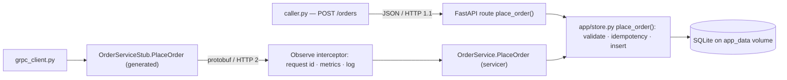

# canteen — Assignment 2 video: script and slide content

Target length: 10 minutes at a normal speaking pace (about 1,450 words of narration).
Each section gives the slide content first (hand this part to Claude for the artifact) and then
the voice-over script. Timings are cumulative targets.

Legend for slide content: **Title** is the slide heading, **Bullets** are the on-screen text,
**Visual** describes a diagram, screenshot or code box to place on the slide. Keep bullets short on
the slide; the detail lives in the narration.

---

## Slide 1 — Title (0:00 – 0:30)

**Title:** canteen: HTTP, gRPC and metrics
**Subtitle:** Enterprise Software Development, Fall 2026 — Assignment 2
**Bullets:**
- Hassan — individual submission
- Repo: github.com/hassan09070/ESD, branch `assignment2`
**Visual:** project name large, a small stack strip of logos or words: FastAPI · SQLite · gRPC · Prometheus · Grafana · Elasticsearch · Kibana

**Script:**
Hi, I'm Hassan. This video covers my Enterprise Software Development project, canteen, and what I added for Assignment 2. I'll go through three things: what the project is and what it does, what I built in Assignment 2 for the HTTP API and the metrics, and then gRPC: what it is, and exactly where and how I implemented it in this project.

---

## Slide 2 — What the project is (0:30 – 1:30)

**Title:** A university canteen order queue
**Bullets:**
- Four shops: sky_dhaba, tapal, cafetogo, grito
- One business flow: place → ready → pick up, or cancel
- Built small on purpose, so every part of the stack can be understood
**Visual:** the state diagram as a flow:
`POST /orders → waiting → POST /orders/{id}/ready → ready → POST /orders/{id}/pickup → picked_up`, with `cancel` branching from waiting and ready to `cancelled`

**Script:**
The project is a university canteen order queue. There are four shops: sky_dhaba sells chai and pharata, tapal sells biryani and pulao, cafetogo has burgers and rolls, and grito has corn and ice cream. The business is deliberately tiny. A customer places an order at a shop, the shop marks it ready, the customer picks it up. Or the order is cancelled. That's the whole domain: one resource, orders, and four transitions.

I kept it small on purpose. The point of the project is not the canteen, it's everything around it: how you observe it, how you design its API properly, and how you expose the same operation over two different protocols. A small domain means every log line, every metric and every status code can be explained.

---

## Slide 3 — The stack (1:30 – 2:30)

**Title:** What runs when you type `docker compose up`
**Bullets:**
- `app`: FastAPI HTTP API, uvicorn
- `grpc`: the PlaceOrder gRPC service, its own container
- `store`: SQLite file on a shared volume, used by both
- `load`: continuous random traffic generator
- Metrics: Prometheus, Grafana, Node Exporter
- Logs: Filebeat → Elasticsearch → Kibana
**Visual:** architecture boxes: two app containers (app, grpc) both pointing to one SQLite cylinder; Prometheus scraping both; Filebeat tailing both into Elasticsearch; Grafana and Kibana on top

**Script:**
Here is what runs. The HTTP API is a FastAPI app. The business rules and the data live in one module, `store.py`, which writes to a SQLite file on a Docker volume. Next to it runs a second container, the gRPC service, which mounts the same volume and uses the same store module. So an order placed over gRPC and an order placed over HTTP land in the same table.

Around them is the observability stack from Assignment 1: Prometheus scrapes metrics from both services every five seconds, Grafana has four dashboards, Node Exporter covers the machine, and every service writes one JSON log line per event, which Filebeat ships into Elasticsearch so I can search them in Kibana. A load generator keeps traffic flowing so the dashboards are never empty. All of that is one `docker compose up`.

---

## Slide 4 — Assignment 1 in one slide (2:30 – 3:00)

**Title:** Where Assignment 1 left it
**Bullets:**
- 9 Prometheus metrics, all four types, business and application
- Structured JSON logs with a request id on every line
- Three Grafana dashboards, Kibana data view
- Chaos endpoints and two experiments: slow requests, label cardinality
**Visual:** a small screenshot of the Business dashboard, or the four metric type names (Counter, Gauge, Histogram, Summary)

**Script:**
Assignment 1 was observability. The app already had nine Prometheus metrics covering all four types, structured JSON logs where every line carries a request id, three Grafana dashboards, and chaos endpoints to make it slow or partly broken for the experiments. Assignment 2 builds on that, so the new pieces had to fit the same logging and metrics conventions. That turned out to matter most for gRPC, and I'll come back to it.

---

## Slide 5 — Assignment 2 at a glance (3:00 – 3:30)

**Title:** Assignment 2: three parts
**Bullets:**
- Part A: make the HTTP API follow good practice
- Part B: the same operation as a gRPC service
- Part C: audit the metrics, add new ones, compare on a dashboard
- 10 new tests, 22 in total
**Visual:** three columns A / B / C with one icon each

**Script:**
Assignment 2 had three parts. Part A was to improve the HTTP API with proper REST practices. Part B was to take one user task, placing an order, and implement it as a gRPC service beside the HTTP one. Part C was to audit the metrics from Assignment 1, add metrics for the new service, and put HTTP and gRPC side by side on a dashboard. I added ten tests along the way, so there are twenty-two in total, and they run without Docker.

---

## Slide 6 — Part A: one error shape, right status codes (3:30 – 4:30)

**Title:** Part A — the API before and after
**Bullets:**
- Before: errors were a string or a list under `detail`, unknown shop was a hand-built 400
- After: every error is `{"error": {"code", "message", "details"}}`
- Validation by Pydantic models: shop is a `Literal` of the four shops, item is 1–40 chars → 422
- Codes: 201 created · 404 unknown order · 409 impossible transition · 422 bad input · 429 rate limited · 503 shop closed
**Visual:** a code box with the error envelope:
```json
{"error": {"code": "validation_error", "message": "invalid input",
           "details": [{"field": "shop", "problem": "Input should be 'sky_dhaba', 'tapal', 'cafetogo' or 'grito'"}]}}
```

**Script:**
Part A started with a review of every endpoint. The biggest problem was that errors had two shapes: a plain string for most failures and a list for validation failures, so any caller needed two parsers. Now every failure, from every route, is one envelope: an error object with a machine-readable code, a message, and details. That's done once with exception handlers, so no route builds its own error body.

Validation moved into the Pydantic models. The shop field is a literal of the four shop names, the item is one to forty characters. An unknown shop used to be a hand-built 400; now it's a 422 like every other validation problem, and the allowed values show up in the OpenAPI spec automatically. Status codes mean one thing each: 201 created, 404 unknown order, 409 for a transition the order's state doesn't allow, 422 bad input, 429 rate limited, 503 when a shop is closed.

---

## Slide 7 — Part A: idempotency and rate limiting (4:30 – 5:30)

**Title:** Safe retries and a fair queue
**Bullets:**
- `Idempotency-Key` header on `POST /orders`: a repeat returns the first order, with `Idempotent-Replayed: true`, never a second row
- Key lookup and insert happen in the same write transaction
- Rate limit: 60 orders per 60 s per client (`X-Client-ID`, else IP)
- 429 carries `Retry-After`; accepted calls carry `X-RateLimit-Remaining`
**Visual:** the rate-limit demo output trimmed:
```
 60  201  remaining=0
 61  429  remaining=0  retry-after=19
```

**Script:**
Two practices protect the one operation that matters, placing an order. First, idempotency. A client that times out and retries used to create a duplicate order. Now it can send an Idempotency-Key header. The store looks the key up inside the same write transaction that would insert the order; if it exists, the stored order comes back with a header saying it was replayed. Two requests, one row. The transitions don't need a key: repeating one is a harmless 409.

Second, rate limiting. Sixty orders per sixty-second window per client, keyed by an X-Client-ID header or the client IP. The demo script fires sixty-five orders from one client: sixty get 201, then 429 with a Retry-After header telling the caller exactly when to come back. Another client in the same window is still accepted.

---

## Slide 8 — Part A: OpenAPI and a resilient caller (5:30 – 6:15)

**Title:** The contract, and a client that behaves
**Bullets:**
- `openapi.json`, 8 paths, generated from the route declarations and models
- A test validates live 201 and 422 bodies against the spec, and that the committed file matches the running app
- `scripts/caller.py`: 2 s timeout · 3 retries with backoff 0.25 → 0.5 → 1 s · circuit breaker opens after 3 failures for 5 s, then one trial call
- Retries are safe because every attempt reuses one Idempotency-Key
**Visual:** the caller demo, four lines: `attempt 1/4 failed: HTTP 503 … retrying in 0.25 s`, `breaker: 3 consecutive failures -> OPEN for 5 s`, `BLOCKED breaker is OPEN, not calling`, `trial call succeeded -> CLOSED`

**Script:**
The OpenAPI document is generated from the code, not written by hand, so it can't drift. Every route declares its success model and its error responses, and a test posts a valid and an invalid order and validates the live bodies against the spec's schemas. A second test checks the committed file equals what the running app serves.

Then I wrote a caller, a small script that behaves like another service calling the API. It has a two-second timeout, three retries with exponential backoff, only on timeouts and 5xx, never on 4xx, and a circuit breaker that opens after three consecutive failures. In the demo I close the tapal shop through the chaos endpoint: the caller retries, the breaker opens, calls are blocked without touching the server, and after recovery one trial call succeeds and closes it again. And because every attempt reuses the same idempotency key, retrying is safe.

---

## Slide 9 — What gRPC is (6:15 – 7:15)

**Title:** gRPC in one minute
**Bullets:**
- A remote procedure call framework: you call a method, not a URL
- Contract first: the API is a `.proto` file; a compiler generates client and server code
- Messages are Protocol Buffers: binary, typed, small
- Runs over HTTP/2: one connection, many calls
- Unary, server streaming, client streaming, bidirectional
- Status is one enum in the trailers: OK, INVALID_ARGUMENT, DEADLINE_EXCEEDED, UNAVAILABLE, INTERNAL …
**Visual:** two columns, HTTP/REST vs gRPC: JSON text vs protobuf binary · URL + verb vs method name · numeric status + body vs status enum · hand-written client vs generated stub

**Script:**
Before the implementation, what gRPC is. With REST you send a verb and a URL and some JSON, and you write the client yourself. With gRPC you call a method. The API is defined first, in a proto file: the service, its methods, and the exact shape of every message. A compiler then generates the client stub and the server base class in your language, so the client and server can't disagree about field names or types.

Messages are Protocol Buffers, a binary format that is small and strictly typed. The calls travel over HTTP/2, so one connection carries many calls. There are four call styles: unary, which is one request and one response, and three streaming styles. And instead of HTTP's numeric codes plus a body you parse, gRPC has one status enum sent in the trailers: OK, INVALID_ARGUMENT, DEADLINE_EXCEEDED, UNAVAILABLE, INTERNAL and so on.

---

## Slide 10 — Where gRPC sits in canteen (7:15 – 8:00)

**Title:** PlaceOrder over gRPC, beside POST /orders
**Bullets:**
- Chosen operation: place an order, the one a user task starts with
- Separate process and container: `grpc` on port 50051, metrics on 9095
- Both handlers call the same `store.place_order()` against the same SQLite file
- The gRPC service never calls the HTTP server
**Visual:** the call-path diagram (Mermaid source below, or redraw as boxes). Shade the two generated/handler boxes.


**Script:**
In canteen, the operation I chose is placing an order, the same thing POST /orders does. The gRPC service is its own process in its own container, listening on port 50051, with a metrics port on 9095 for Prometheus. The key design decision is on this diagram: both the HTTP route and the gRPC handler call the same function, place_order in the store module, against the same SQLite file. The gRPC service never calls the HTTP server, and nothing is duplicated. Validation, the idempotency key and the insert are written once. There's a test that places an order over gRPC and then reads it over HTTP.

---

## Slide 11 — The contract and the generated code (8:00 – 8:40)

**Title:** `canteen.proto` → generated Python
**Bullets:**
- `service OrderService { rpc PlaceOrder (PlaceOrderRequest) returns (Order); }`
- `PlaceOrderRequest { shop, item, idempotency_key }`
- `Order { order_id, shop, item, state, placed_at, replayed }`
- Unary: one request, one small answer
- One command generates `canteen_pb2.py` (messages) and `canteen_pb2_grpc.py` (stub, servicer)
**Visual:** code box with the proto service and the two messages; a second small box with the generate command:
```sh
uv run python -m grpc_tools.protoc -I . --python_out=. --grpc_python_out=. --pyi_out=. grpc_service/canteen.proto
```

**Script:**
The contract is one proto file. One service, OrderService, with one method, PlaceOrder. The request has a shop, an item and an optional idempotency key. The reply is the Order message: id, shop, item, state, the placed-at time, and a replayed flag that's true when the call was answered from a stored key. Unary is enough here: one request, one small answer.

One protoc command turns that into two Python modules: the messages, and the stub plus servicer base class. The server subclasses the servicer and implements PlaceOrder; the client calls the stub. Neither side ever builds a message by hand.

---

## Slide 12 — Server, interceptor, client (8:40 – 9:25)

**Title:** How the service is implemented
**Bullets:**
- Handler: `store.place_order()`; a `DomainError` becomes `INVALID_ARGUMENT`; replays and placed orders bump the same counters as HTTP
- `Observe` interceptor, the twin of the HTTP middleware: request id from `x-request-id` metadata, bound to every log line and echoed in the trailers; metrics; one `grpc_request` log line; unexpected exception → `INTERNAL`
- Client `scripts/grpc_client.py`: deadline 2 s, `x-request-id` metadata, prints `CODE: details` on failure
- Filebeat tails the gRPC container too, so one Kibana search on a request id shows both processes
**Visual:** the two client runs:
```
OK     order_id=4d00889b shop=tapal state=waiting replayed=False (33.4 ms) request_id=trace-demo-1
ERROR  INVALID_ARGUMENT: unknown shop 'pizza'; choose one of [...] (3.0 ms)
```

**Script:**
The handler itself is short. It calls place_order; if the store raises a domain error, unknown shop or bad item, the call is aborted with INVALID_ARGUMENT, which is the gRPC twin of our 422. A replay increments the same idempotent-replays counter the HTTP side uses, with the label api equals grpc.

Everything else lives in one server interceptor, which mirrors the HTTP middleware exactly. It takes the request id from the x-request-id call metadata, or generates one, binds it so every log line of the call carries it, and echoes it back in the trailing metadata. It records the metrics, writes one grpc_request log line per call, and turns any unexpected exception into INTERNAL. Because Filebeat also tails the gRPC container, a single Kibana search on a request id returns the lines from both processes. That's the Assignment 1 trace correlation surviving the protocol boundary.

The client sets a two-second deadline and the request id, and prints either the order or the status code and details.

---

## Slide 13 — Part C: metrics and the comparison dashboard (9:25 – 9:50)

**Title:** Measuring both versions
**Bullets:**
- Fixed: `canteen_orders_waiting` was in-memory in one process; now read from the store at scrape time by both
- New: `canteen_grpc_server_handled_total{grpc_method, grpc_code}` · `canteen_grpc_server_handling_seconds` · `canteen_grpc_server_in_flight` · `canteen_idempotent_replays_total{api}`
- Same histogram buckets as HTTP, so the percentiles are comparable
- Dashboard "HTTP vs gRPC: place order": calls/s by status and by code, error share, p50/p95, in-flight, replays and 429s
- Measured after the demo runs: gRPC p50/p95 2.6 / 4.9 ms · HTTP 7.4 / 22.7 ms (server-side)
**Visual:** the dashboard screenshot `docs/screenshots/a2_http_vs_grpc.png`

**Script:**
Part C started with an audit. One Assignment 1 metric was wrong once there were two writers: the orders-waiting gauge was incremented in one process's memory, so a gRPC order never raised it. It now reads the queue length from the store at scrape time, in both processes. I added three gRPC metrics, calls by method and status, server-side latency, and in-flight calls, plus a counter of idempotent replays labelled by API. The latency histogram uses the same buckets as the HTTP one, so the two can be compared honestly. On the dashboard, after the demo runs, gRPC PlaceOrder had a p50 of about 2.6 milliseconds and a p95 of about 4.9, against 7.4 and 22.7 for the HTTP version, measured at the server.

---

## Slide 14 — Wrap up (9:50 – 10:00)

**Title:** Summary
**Bullets:**
- One operation, two protocols, one source of truth
- HTTP: one error shape, idempotency, rate limit, OpenAPI, resilient caller
- gRPC: proto → generated code → servicer + interceptor → client, with the same logs and metrics
- 22 tests, four dashboards, everything in `REPORT2.md`
**Visual:** repo link and the branch name

**Script:**
To sum up: one operation, two protocols, one source of truth. The HTTP API now has a single error shape, idempotent creates, a rate limit, a generated OpenAPI contract and a caller that retries and breaks safely. The gRPC service implements the same operation from a proto contract through generated code, with an interceptor that gives it the same logs, request ids and metrics as the HTTP side. Everything is tested and documented in the report. Thanks for watching.

---

## Notes for recording

- Word count of the script is about 1,450; at a steady pace that is 10 minutes. If you run long, slides 4 and 8 are the easiest to trim.
- Have these open for optional screen cuts: Swagger UI (`localhost:8000/docs`), the HTTP vs gRPC Grafana dashboard (`localhost:3000/d/canteen-grpc`), a terminal running `scripts/grpc_client.py`, and Kibana filtered on `request_id : "trace-demo-1"`.
- If you show the dashboard live, spread gRPC calls over a few minutes first; a single burst before the first scrape gives flat or NaN percentile panels.
